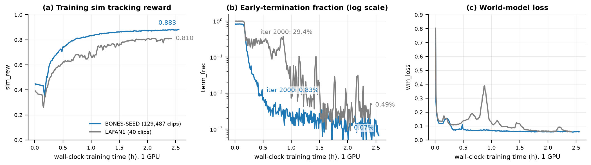
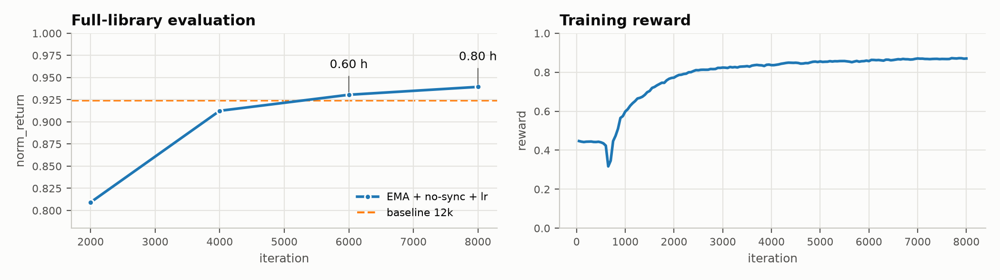

<h1 align="center">UniSuperMimic</h1>

<h3 align="center">SuperMimic reproduction on UniLab</h3>

<p align="center">Languages: English | <a href="README_zh.md">简体中文</a></p>

<p align="center">
  <a href="https://arxiv.org/abs/2610.28480"></a>
  <a href="https://pypi.org/project/unilab/"></a>
  <a href="#bones-seed-library-129487-clips"></a>
  <a href="#results"></a>
  <a href="LICENSE"></a>
</p>

UniSuperMimic is an independent downstream reproduction of [SuperMimic](https://supermimic.github.io) on **UniLab** for Unitree G1 whole-body tracking, with **mjwarp, MuJoCo, and Motrix** backends. It includes a differentiable world model, a goal-conditioned policy, a Manager-Based task, pipelines for the 40-clip LAFAN1 set and the 129,487-clip BONES-SEED compact library, and entry points for training and deterministic full-library evaluation.

### Highlights

- **BONES-SEED at scale**: download, convert, filter, pack, train on, and deterministically evaluate a 129,487-clip / 47.3M-frame motion library from one repository.
- **Single-GPU efficiency**: mjwarp, MuJoCo, and Motrix all support an efficient one-GPU workflow, reaching a strong BONES-SEED checkpoint in about 40 minutes; the complete 12,000-iteration validation run is reported below.
- **Three simulation backends**: switch between mjwarp, MuJoCo, and Motrix without changing the policy or dataset configuration.

<p align="center">
  <a href="docs/assets/supermimic_comparison.mp4"></a>
</p>

<p align="center"><em>Solid robot: SuperMimic policy. Blue ghost: reference motion. Click the image to view the MP4.</em></p>

Paper: [*SuperMimic: Scaling Humanoid Whole-Body Control with One Differentiable World Model*](https://arxiv.org/abs/2610.28480), Qiayuan Liao et al. The implementation references `supermimic_vibed` and depends on PyPI `unilab`.

## Repository Structure

```text
unisupermimic/
├── src/unisupermimic/
│   ├── rl/
│   │   ├── algos/supermimic/       # World model, policy, critic, replay, and learner
│   │   └── contracts/supermimic.py # Environment/algorithm tensor contract
│   ├── tasks/motion_tracking/g1/supermimic/
│   │   ├── env.py                  # Manager-Based environment and backend factory
│   │   ├── manager_terms.py        # Command/action/observation/event/reward terms
│   │   ├── motion.py, mdp.py       # Motion library and differentiable MDP
│   │   ├── evaluate.py             # Deterministic full-clip evaluation from frame zero
│   │   ├── render.py               # Policy rollout and reference-motion comparison video
│   │   └── registry.py             # G1SuperMimic registration
│   ├── scripts/train_supermimic.py # Training, resume, and evaluation entry point
│   ├── conf/supermimic/            # Hydra configuration
│   ├── data/boneseed.py            # BONES-SEED download/convert/filter/pack CLI
│   ├── assets/robots/g1/           # G1 MJCF; meshes/URDF are downloaded and untracked
│   ├── assets/motions/             # LAFAN1 CSV files, downloaded and untracked
│   └── sim2sim.py                  # Policy I/O, network shape, and asset identity checks
├── docs/assets/                    # Result curves, MP4, and GIF
├── tools/prepare_supermimic_assets.py
├── tests/
├── pyproject.toml, uv.lock
├── LICENSE, LICENSES/, NOTICE
└── Makefile
```

## Installation

Requirements: Linux, Python 3.10–3.13, and [uv](https://docs.astral.sh/uv/). A CUDA GPU is required for mjwarp training. Run all commands from the repository root. `uv run` uses `uv.lock` to synchronize the project, PyPI `unilab`, all three simulation backends, and development dependencies.

```bash
uv run unisupermimic-train --help
```

Run `uv lock` after changing dependencies.

On AMD ROCm hosts, install from the pre-resolved ROCm lockfile instead (a ROCm
PyTorch build with the same pinned dependency set):

```bash
make sync-rocm
```

CUDA-only backends (mjwarp) stay unsupported there; train with the MuJoCo
host-bridge backend (`task=g1_super_mimic/mujoco`). `make sync-rocm` swaps
`pyproject.toml`/`uv.lock` for the ROCm profile; run `make sync-default` to
switch back. Maintainers regenerate the ROCm lockfile after dependency changes
with `make lock-rocm`.

### Prepare Assets and Choose a Dataset

Both training modes use the same G1 robot model, but **you only need to download the dataset you plan to train on**. LAFAN1 and BONES-SEED are independent choices; downloading one does not require downloading the other.

### Shared G1 Robot Assets

If you plan to use BONES-SEED only, prepare the robot without downloading LAFAN1 motions:

```bash
uv run tools/prepare_supermimic_assets.py --robot-only

# Optional: validate an existing robot-only installation offline.
uv run tools/prepare_supermimic_assets.py --robot-only --validate-only
```

### Option A: LAFAN1

Use this option for the default 40-clip setup. The command prepares the shared robot and downloads the LAFAN1/G1 motions, so no separate robot-only command is needed:

```bash
uv run tools/prepare_supermimic_assets.py

# Validate both the robot and all LAFAN1 motions offline.
uv run tools/prepare_supermimic_assets.py --validate-only
```

The source is `lvhaidong/LAFAN1_Retargeting_Dataset`. A complete motion set contains 40 CSV files with 264,705 source frames and 36 columns per frame.

### Option B: BONES-SEED

Use this option for the large-scale setup. Prepare the shared robot with `--robot-only` first if it is not already installed, then run:

```bash
# Full BONES-SEED pipeline: download -> convert -> filter -> pack.
uv run unisupermimic-boneseed all --workers 16

# If raw CSVs are already downloaded, resume or run individual stages.
uv run unisupermimic-boneseed convert --workers 16
uv run unisupermimic-boneseed filter --workers 16
uv run unisupermimic-boneseed pack
```

Following `SuperMimic-Reproduced`, the pipeline resamples 120 fps CSV to 50 Hz NPZ with MuJoCo forward kinematics, applies name and feasibility filters, and packs retained clips into a 71-dimensional fp16 library. The source is Hugging Face `bones-studio/seed`, file `g1.tar.gz`.

Paths default to `data/raw/bones_seed` for raw CSV, `data/npz/bones_seed` for NPZ and manifests, and `data/library/bones_seed_compact.pt` for the training library. Conversion skips existing NPZ files unless `--overwrite` is set; `--limit` supports a small trial. The reference full-set result has about 129.5k clips and a roughly 6.7 GB fp16 library, which is resident on the training device. Raw CSV and intermediate NPZ require additional disk space.

Meshes, URDF, motion files, logs, checkpoints, and generated dataset directories are excluded by `.gitignore`. Dataset licenses remain with their respective owners.

## Training

Run commands from the repository root and set `CUDA_VISIBLE_DEVICES` to an available GPU. Both datasets use `unisupermimic-train`; the motion-file configuration selects the training entry.

### Train with LAFAN1

LAFAN1 is the default dataset, so no motion-file override is needed:

```bash
# mjwarp, 4096 parallel environments, 12000 iterations.
CUDA_VISIBLE_DEVICES=0 uv run unisupermimic-train \
  training.log_dir=runs/supermimic_mjwarp_001

# Resume this LAFAN1 run from last.pt and train to 16000 iterations.
CUDA_VISIBLE_DEVICES=0 uv run unisupermimic-train \
  algo.resume=true \
  algo.load_run=runs/supermimic_mjwarp_001 \
  algo.checkpoint=last.pt \
  algo.iterations=16000
```

### Train with BONES-SEED

After building the compact library, select it explicitly with `env.commands.motion.motion_files`. This replaces the default LAFAN1 list rather than adding to it:

```bash
CUDA_VISIBLE_DEVICES=0 uv run unisupermimic-train \
  'env.commands.motion.motion_files=[data/library/bones_seed_compact.pt]' \
  training.log_dir=runs/supermimic_boneseed_001

# Resume the BONES-SEED run with the same dataset selection.
CUDA_VISIBLE_DEVICES=0 uv run unisupermimic-train \
  'env.commands.motion.motion_files=[data/library/bones_seed_compact.pt]' \
  algo.resume=true \
  algo.load_run=runs/supermimic_boneseed_001 \
  algo.checkpoint=last.pt \
  algo.iterations=16000
```

The quoted Hydra list contains one library file, not one motion clip; clip metadata is read from the library. Keep this dataset override when resuming or evaluating a BONES-SEED run through `unisupermimic-train`.

### Backend and Other Options

The backend selection is independent of the dataset. For example, the following commands use the default LAFAN1 library; add the BONES-SEED motion-file override to use that library instead:

```bash
# Select MuJoCo through the task owner.
uv run unisupermimic-train \
  task=g1_super_mimic/mujoco \
  training.log_dir=runs/supermimic_mujoco_001

# Select Motrix through the task owner.
uv run unisupermimic-train \
  task=g1_super_mimic/motrix \
  training.log_dir=runs/supermimic_motrix_001
```

Use the same `task=g1_super_mimic/<backend>` override when resuming or evaluating a MuJoCo or Motrix run. Motrix uses fixed friction; center-of-mass and joint-offset domain randomization remain enabled. Use Hydra syntax for other configuration overrides. For a quick smoke run, override options such as `algo.num_envs`, `algo.iterations`, `algo.wm_hidden`, `algo.policy_hidden`, and `algo.compile=false`. See `src/unisupermimic/conf/supermimic/config.yaml` for the complete default configuration.

## Evaluation

Evaluation starts every motion from its first frame, disables observation and action noise, and runs the complete clip. Finished environments are recycled for pending clips, with longer clips scheduled first to avoid a long idle batch tail. The standalone evaluator uses at most 16,384 parallel environments by default; use `unisupermimic-eval --num_envs N` to fit a smaller GPU. Strict sim2sim validation checks policy I/O, network shape, motion library, and MJCF identity before environment construction.

```bash
CUDA_VISIBLE_DEVICES=0 uv run unisupermimic-train \
  training.play_only=true \
  algo.load_run=runs/supermimic_mjwarp_001 \
  algo.checkpoint=12000
```

Results are written to `ckpt_012000_eval.json` in the same directory. You can also evaluate a checkpoint directly. The standalone evaluator and video exporter accept `--backend mjwarp`, `--backend mujoco`, or `--backend motrix` and default to mjwarp:

```bash
CUDA_VISIBLE_DEVICES=0 uv run unisupermimic-eval \
  --backend mjwarp \
  --ckpt runs/supermimic_mjwarp_001/ckpt_012000.pt
```

## Video Export

The following command rolls out `jumps1_subject1` continuously from a checkpoint, trims the result to the jumping segment from 6–14 seconds, and writes a 25 fps comparison MP4:

```bash
CUDA_VISIBLE_DEVICES=0 MUJOCO_GL=egl uv run unisupermimic-video \
  --backend mjwarp \
  --ckpt runs/supermimic_mjwarp_001/ckpt_012000.pt \
  --clip jumps1_subject1 \
  --start 6 \
  --seconds 8 \
  --output docs/assets/supermimic_comparison.mp4
```

By default, the reference root XY is aligned with the policy to highlight whole-body tracking. Pass `--global-ghost` to preserve the reference motion's global displacement.

## Results

### LAFAN1 library (40 clips)

Configuration: PyPI `unilab 1.5.0`, mjwarp, and 4096 training environments. Evaluation covers 40 LAFAN1/G1 motions. `norm_return` is the macro average across clips; `frame-weighted` is weighted by clip length.

| checkpoint | norm_return | frame-weighted | failed clips |
|---|---:|---:|---:|
| [ckpt_012000.pt](https://github.com/Motphys/Uni-SuperMimic/releases/download/checkpoints-v1/lafan1_ckpt_012000.pt) | 0.827227 | 0.829952 | 0 / 40 |


### BONES-SEED library (129,487 clips)

Same configuration on the BONES-SEED G1 compact library (129,487 kept clips, 47.3M frames, 6.72 GB fp16): one RTX 4090 (48 GB), 12000 iterations, 1.69 h learner wall time. Evaluation covers the complete kept library with deterministic full-clip rollouts. The recorded result was produced by the original one-environment-per-clip evaluator; current evaluation recycles finished environments instead. The LAFAN1 row is a baseline run with identical settings.

| policy | eval set | norm_return | frame-weighted | failed clips |
|---|---|---:|---:|---:|
| BONES-SEED [ckpt_012000.pt](https://github.com/Motphys/Uni-SuperMimic/releases/download/checkpoints-v1/boneseed_ckpt_012000.pt) | all 129,487 kept clips | 0.9243 | 0.9267 | 350 / 129,487 (0.27%) |
| LAFAN1 [ckpt_012000.pt](https://github.com/Motphys/Uni-SuperMimic/releases/download/checkpoints-v1/lafan1_ckpt_012000.pt) (baseline) | all 40 clips | 0.8336 | 0.8366 | 0 / 40 |



Per-clip distribution on BONES-SEED: median 0.9528, P10 0.8337, P90 0.9841. BONES-SEED converges much faster (early-termination 0.83% vs 29.4% at iteration 2000) and finishes higher on both training reward and evaluation return. An independent RTX 5090 run reproduces these numbers (0.9262 on a random 10,000-clip subset, within 0.002 of the full-library value).

### BONES-SEED with EMA and no-sync training (8000 iterations)

Building on the fused 3×3 rotations and fused Adam already in this repository, an EMA policy (`pi_ema: 0.995`), no host-device syncs (`no_sync: true`), and `lr: 4e-4` reach a higher return in two-thirds of the iterations on the same one RTX 4090 (48 GB). Every checkpoint is evaluated on the complete 129,487-clip library.

| checkpoint | iterations | norm_return | frame-weighted | failed clips |
|---|---|---:|---:|---:|
| ckpt_002000.pt | 2000 | 0.8092 | 0.8187 | 1901 / 129,487 (1.47%) |
| ckpt_004000.pt | 4000 | 0.9125 | 0.9165 | 660 / 129,487 (0.51%) |
| ckpt_006000.pt | 6000 | 0.9306 | 0.9342 | 206 / 129,487 (0.16%) |
| [ckpt_008000.pt](https://github.com/Motphys/Uni-SuperMimic/releases/download/checkpoints-v1/boneseed_ema_nosync_ckpt_008000.pt) | 8000 | 0.9395 | 0.9433 | 193 / 129,487 (0.15%) |



At 8000 iterations this configuration already exceeds the 12000-iteration baseline on normalized return (0.9395 vs 0.9243) and halves the number of failed clips (193 vs 350).

## Tests

```bash
make check       # ruff, mypy, pyright
make test        # Non-slow tests
make test-all    # Include production backend slow tests; mjwarp requires CUDA
uv run tools/prepare_supermimic_assets.py --validate-only
```

## License

The repository code is released under [Apache-2.0](LICENSE). The reference implementations' MIT licenses and original copyright notices are preserved in [LICENSES/MIT-supermimic.txt](LICENSES/MIT-supermimic.txt) and [LICENSES/MIT-supermimic-reproduced.txt](LICENSES/MIT-supermimic-reproduced.txt); see also [NOTICE](NOTICE). UniLab, UniSim, MuJoCo/mjwarp, MotrixSim, and the datasets retain their respective upstream licenses. This repository does not relicense those external dependencies or downloaded assets.
