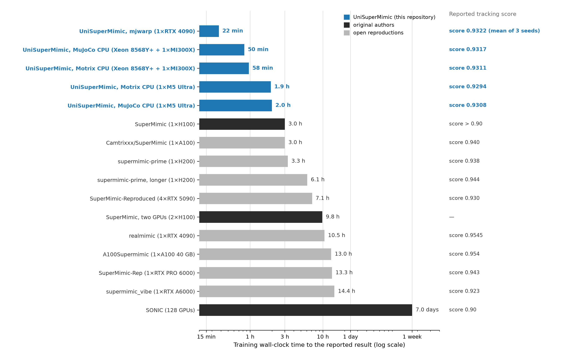
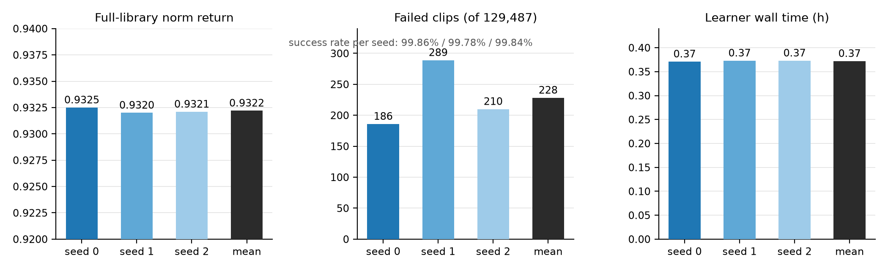
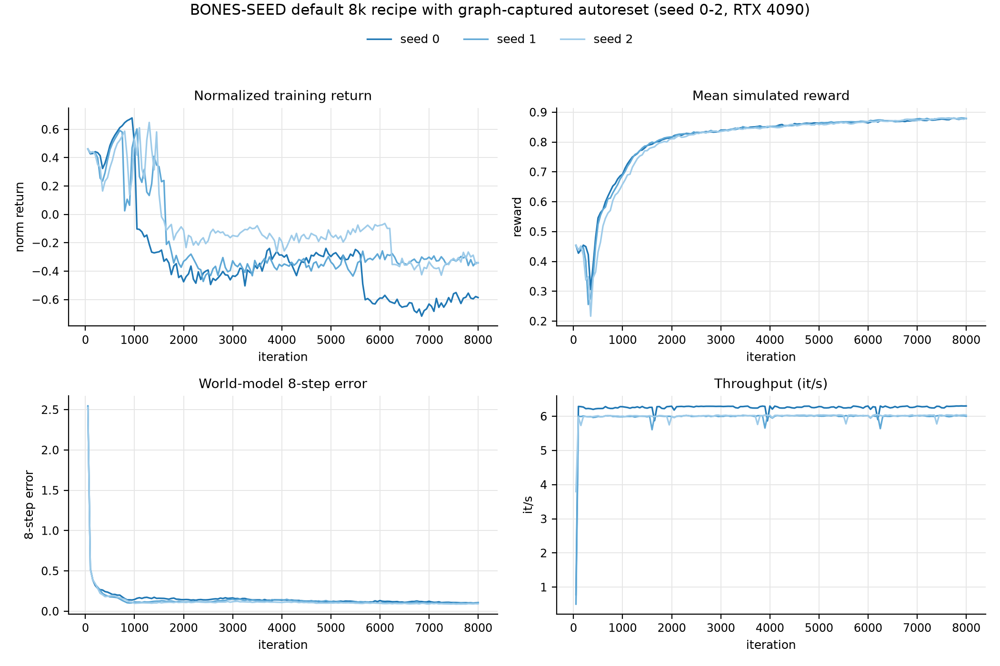

<h1 align="center">UniSuperMimic</h1>

<h3 align="center">SuperMimic reproduction on UniLab</h3>

<p align="center">Languages: English | <a href="README_zh.md">简体中文</a></p>

<p align="center">
  <a href="https://arxiv.org/abs/2610.28480"></a>
  <a href="https://pypi.org/project/unilab/"></a>
  <a href="#results"></a>
  <a href="#results"></a>
  <a href="LICENSE"></a>
</p>

UniSuperMimic is an independent downstream reproduction of [SuperMimic](https://supermimic.github.io) on **UniLab** for Unitree G1 whole-body tracking, with **mjwarp, MuJoCo, and Motrix** backends. It includes a differentiable world model, a goal-conditioned policy, a Manager-Based task, pipelines for the 40-clip LAFAN1 set and the 129,487-clip BONES-SEED compact library, and entry points for training and deterministic full-library evaluation.

### Highlights

- **BONES-SEED at scale**: download, convert, filter, pack, train on, and deterministically evaluate a 129,487-clip / 47.3M-frame motion library from one repository.
- **Graph-captured fixed-shape autoreset**: unilab 1.6.0 pins body-packet storage across resets and publishes caller-owned step outputs, so the reset segment runs as a replayed CUDA graph — the default 8,000-iteration BONES-SEED recipe trains in **about 22 minutes on one RTX 4090** (mean of 3 seeds: 0.9322 full-library norm return, 99.82% clip success rate).
- **Single-GPU efficiency**: mjwarp, MuJoCo, and Motrix all support an efficient one-GPU workflow; learner throughput reaches ~6 it/s with the graph-captured autoreset chain.
- **Three simulation backends**: switch between mjwarp, MuJoCo, and Motrix without changing the policy or dataset configuration.

<p align="center">
  <a href="docs/assets/supermimic_comparison.mp4"></a>
</p>

<p align="center"><em>Solid robot: SuperMimic policy. Blue ghost: reference motion. Click the image to view the MP4.</em></p>

<p align="center">
  
</p>

<p align="center"><em>Training wall-clock time to the reported result, with each project's reported tracking score and failed clips (log-scale time axis). Historical runs and ablations are archived in <a href="docs/results_history.md">docs/results_history.md</a>.</em></p>

Paper: [*SuperMimic: Scaling Humanoid Whole-Body Control with One Differentiable World Model*](https://arxiv.org/abs/2610.28480), Qiayuan Liao et al. The implementation references `supermimic_vibed` and depends on PyPI `unilab`.

## Repository Structure

```text
unisupermimic/
├── src/unisupermimic/
│   ├── rl/
│   │   ├── algos/supermimic/       # World model, policy, critic, replay, and learner
│   │   └── contracts/supermimic.py # Environment/algorithm tensor contract
│   ├── tasks/motion_tracking/g1/supermimic/
│   │   ├── env.py                  # Manager-Based environment and backend factory
│   │   ├── manager_terms.py        # Command/action/observation/event/reward terms
│   │   ├── motion.py, mdp.py       # Motion library and differentiable MDP
│   │   ├── evaluate.py             # Deterministic full-clip evaluation from frame zero
│   │   ├── render.py               # Policy rollout and reference-motion comparison video
│   │   └── registry.py             # G1SuperMimic registration
│   ├── scripts/train_supermimic.py # Training, resume, and evaluation entry point
│   ├── conf/supermimic/            # Hydra configuration
│   ├── data/boneseed.py            # BONES-SEED download/convert/filter/pack CLI
│   ├── assets/robots/g1/           # G1 MJCF; meshes/URDF are downloaded and untracked
│   ├── assets/motions/             # LAFAN1 CSV files, downloaded and untracked
│   └── sim2sim.py                  # Policy I/O, network shape, and asset identity checks
├── docs/assets/                    # Result curves, MP4, and GIF
├── tools/prepare_supermimic_assets.py
├── tests/
├── pyproject.toml, uv.lock
├── LICENSE, LICENSES/, NOTICE
└── Makefile
```

## Installation

Requirements: Linux, Python 3.10–3.13, and [uv](https://docs.astral.sh/uv/). A CUDA GPU is required for mjwarp training. Run all commands from the repository root. `uv run` uses `uv.lock` to synchronize the project, PyPI `unilab`, all three simulation backends, and development dependencies.

```bash
uv run unisupermimic-train --help
```

Run `uv lock` after changing dependencies.

On AMD ROCm hosts, install from the pre-resolved ROCm lockfile instead (a ROCm
PyTorch build with the same pinned dependency set):

```bash
make sync-rocm
```

CUDA-only backends (mjwarp) stay unsupported there; train with the MuJoCo
host-bridge backend (`task=g1_super_mimic/mujoco`). `make sync-rocm` swaps
`pyproject.toml`/`uv.lock` for the ROCm profile; run `make sync-default` to
switch back. Maintainers regenerate the ROCm lockfile after dependency changes
with `make lock-rocm`.

### Prepare Assets and Choose a Dataset

Both training modes use the same G1 robot model, but **you only need to download the dataset you plan to train on**. LAFAN1 and BONES-SEED are independent choices; downloading one does not require downloading the other.

### Shared G1 Robot Assets

If you plan to use BONES-SEED only, prepare the robot without downloading LAFAN1 motions:

```bash
uv run tools/prepare_supermimic_assets.py --robot-only

# Optional: validate an existing robot-only installation offline.
uv run tools/prepare_supermimic_assets.py --robot-only --validate-only
```

### Option A: LAFAN1

Use this option for the default 40-clip setup. The command prepares the shared robot and downloads the LAFAN1/G1 motions, so no separate robot-only command is needed:

```bash
uv run tools/prepare_supermimic_assets.py

# Validate both the robot and all LAFAN1 motions offline.
uv run tools/prepare_supermimic_assets.py --validate-only
```

The source is `lvhaidong/LAFAN1_Retargeting_Dataset`. A complete motion set contains 40 CSV files with 264,705 source frames and 36 columns per frame.

### Option B: BONES-SEED

Use this option for the large-scale setup. Prepare the shared robot with `--robot-only` first if it is not already installed, then run:

```bash
# Full BONES-SEED pipeline: download -> convert -> filter -> pack.
uv run unisupermimic-boneseed all --workers 16

# If raw CSVs are already downloaded, resume or run individual stages.
uv run unisupermimic-boneseed convert --workers 16
uv run unisupermimic-boneseed filter --workers 16
uv run unisupermimic-boneseed pack
```

Following `SuperMimic-Reproduced`, the pipeline resamples 120 fps CSV to 50 Hz NPZ with MuJoCo forward kinematics, applies name and feasibility filters, and packs retained clips into a 71-dimensional fp16 library. The source is Hugging Face `bones-studio/seed`, file `g1.tar.gz`.

Paths default to `data/raw/bones_seed` for raw CSV, `data/npz/bones_seed` for NPZ and manifests, and `data/library/bones_seed_compact.pt` for the training library. Conversion skips existing NPZ files unless `--overwrite` is set; `--limit` supports a small trial. The reference full-set result has about 129.5k clips and a roughly 6.7 GB fp16 library, which is resident on the training device. Raw CSV and intermediate NPZ require additional disk space.

Meshes, URDF, motion files, logs, checkpoints, and generated dataset directories are excluded by `.gitignore`. Dataset licenses remain with their respective owners.

## Training

Run commands from the repository root and set `CUDA_VISIBLE_DEVICES` to an available GPU. Both datasets use `unisupermimic-train`; the motion-file configuration selects the training entry.

### Train with LAFAN1

LAFAN1 is the default dataset, so no motion-file override is needed:

```bash
# mjwarp, 4096 parallel environments, 8000 iterations.
CUDA_VISIBLE_DEVICES=0 uv run unisupermimic-train \
  training.log_dir=runs/supermimic_mjwarp_001

# Resume this LAFAN1 run from last.pt and train to 16000 iterations.
CUDA_VISIBLE_DEVICES=0 uv run unisupermimic-train \
  algo.resume=true \
  algo.load_run=runs/supermimic_mjwarp_001 \
  algo.checkpoint=last.pt \
  algo.iterations=16000
```

### Train with BONES-SEED

After building the compact library, select it explicitly with `env.commands.motion.motion_files`. This replaces the default LAFAN1 list rather than adding to it:

```bash
CUDA_VISIBLE_DEVICES=0 uv run unisupermimic-train \
  'env.commands.motion.motion_files=[data/library/bones_seed_compact.pt]' \
  training.log_dir=runs/supermimic_boneseed_001

# Resume the BONES-SEED run with the same dataset selection.
CUDA_VISIBLE_DEVICES=0 uv run unisupermimic-train \
  'env.commands.motion.motion_files=[data/library/bones_seed_compact.pt]' \
  algo.resume=true \
  algo.load_run=runs/supermimic_boneseed_001 \
  algo.checkpoint=last.pt \
  algo.iterations=16000
```

The quoted Hydra list contains one library file, not one motion clip; clip metadata is read from the library. Keep this dataset override when resuming or evaluating a BONES-SEED run through `unisupermimic-train`.

### Backend and Other Options

The backend selection is independent of the dataset. For example, the following commands use the default LAFAN1 library; add the BONES-SEED motion-file override to use that library instead:

```bash
# Select MuJoCo through the task owner.
uv run unisupermimic-train \
  task=g1_super_mimic/mujoco \
  training.log_dir=runs/supermimic_mujoco_001

# Select Motrix through the task owner.
uv run unisupermimic-train \
  task=g1_super_mimic/motrix \
  training.log_dir=runs/supermimic_motrix_001
```

Use the same `task=g1_super_mimic/<backend>` override when resuming or evaluating a MuJoCo or Motrix run. Motrix uses fixed friction; center-of-mass and joint-offset domain randomization remain enabled. Use Hydra syntax for other configuration overrides. For a quick smoke run, override options such as `algo.num_envs`, `algo.iterations`, `algo.wm_hidden`, `algo.policy_hidden`, and `algo.compile=false`. See `src/unisupermimic/conf/supermimic/config.yaml` for the complete default configuration.

The optimizer remains Adam by default. To use Muon for the hidden weight matrices of the policy and world model (with Adam retained for input/output layers, vectors, normalizers, and the critic), add:

```bash
algo.pi_opt=muon algo.wm_opt=muon
```

Muon uses `match_rms_adamw` scaling, so the existing `algo.lr` and cosine schedule are reused. The two options can also be enabled independently.

## Evaluation

Evaluation starts every motion from its first frame, disables observation and action noise, and runs the complete clip. Finished environments are recycled for pending clips, with longer clips scheduled first to avoid a long idle batch tail. The standalone evaluator uses at most 16,384 parallel environments by default; use `unisupermimic-eval --num_envs N` to fit a smaller GPU. Strict sim2sim validation checks policy I/O, network shape, motion library, and MJCF identity before environment construction.

The standalone evaluator and video exporter accept `--backend mjwarp`, `--backend mujoco`, or `--backend motrix` and default to mjwarp:

```bash
CUDA_VISIBLE_DEVICES=0 uv run unisupermimic-eval \
  --backend mjwarp \
  --ckpt runs/supermimic_mjwarp_001/ckpt_012000.pt
```

### Viser Batch Playback

Add `--viser` to direct checkpoint evaluation to inspect multiple deterministic rollouts in a browser. This reuses UniLab's Viser renderer, so neither a local display nor `MUJOCO_GL` is required:

```bash
CUDA_VISIBLE_DEVICES=0 uv run unisupermimic-eval \
  --backend mjwarp \
  --ckpt runs/supermimic_mjwarp_001/ckpt_012000.pt \
  --viser \
  --viser_max_envs 16 \
  --viser_port 8080
```

The evaluator reads `run_config.json` beside the checkpoint and reuses its recorded motion library, so no separate motion-file override is needed. The example above selects the run's LAFAN1 library. To render BONES-SEED instead, select a BONES-SEED checkpoint; its run configuration automatically selects `data/library/bones_seed_compact.pt`:

```bash
CUDA_VISIBLE_DEVICES=0 uv run unisupermimic-eval \
  --backend mjwarp \
  --ckpt runs/supermimic_boneseed_001/ckpt_012000.pt \
  --viser \
  --viser_max_envs 16
```

If `run_config.json` is absent, evaluation falls back to the default LAFAN1 library.

Open <http://localhost:8080>. The **Controls** panel switches between the batch grid and a single environment, and provides pause, single-step, and speed controls. Viser mode creates at most 16 simulation environments by default; use `--num_envs N` to change the runtime batch size and `--viser_max_envs N` to cap the number visible in the grid. Finished environments load pending clips and restart their assigned clips after the library is exhausted. Additional options include `--render_spacing`, `--viser_display single`, `--viser_env_idx`, `--start_paused`, and `--speed`. Press Ctrl+C in the terminal to stop the server.

For a remote GPU server, forward the port before opening the browser: `ssh -L 8080:localhost:8080 <server>`. Viser playback is interactive and does not write an MP4; use the video exporter below for file output.

## Video Export

The following command rolls out `jumps1_subject1` continuously from a checkpoint, trims the result to the jumping segment from 6–14 seconds, and writes a 25 fps comparison MP4:

```bash
CUDA_VISIBLE_DEVICES=0 MUJOCO_GL=egl uv run unisupermimic-video \
  --backend mjwarp \
  --ckpt runs/supermimic_mjwarp_001/ckpt_012000.pt \
  --clip jumps1_subject1 \
  --start 6 \
  --seconds 8 \
  --output docs/assets/supermimic_comparison.mp4
```

By default, the reference root XY is aligned with the policy to highlight whole-body tracking. Pass `--global-ghost` to preserve the reference motion's global displacement.

## Results

Previous result tables and ablations (LAFAN1, the 12000-iteration BONES-SEED run, EMA/no-sync, Muon, and the pre-graph default recipe) are archived in [docs/results_history.md](docs/results_history.md).

### BONES-SEED default recipe with graph-captured autoreset (8000 iterations)

The default recipe trains with unilab 1.6.0's fixed-shape autoreset chain enabled through the single `env.autoreset_cuda_graph` switch: masked autoreset, persistent step buffers, deferred finite validation, and reset-segment CUDA graph capture on top of the task-side fixed-address state-publication carriers. Deterministic evaluation keeps the selected-row reset lifecycle, so the evaluation contract is unchanged.

Three seeds (mjwarp, 4096 environments, one RTX 4090, the complete 129,487-clip library); deterministic full-library evaluation with 16,384 environments from frame zero without noise. A failed clip is one whose rollout hard-terminates (falls) before the clip ends — the SuperMimic-family protocol:

| seed | norm return | frame-weighted | failed clips | success rate | learner wall |
|---|---:|---:|---:|---:|---:|
| 0 | 0.9325 | 0.9285 | 186 | 99.86% | 0.371 h |
| 1 | 0.9320 | 0.9276 | 289 | 99.78% | 0.373 h |
| 2 | 0.9321 | 0.9281 | 210 | 99.84% | 0.373 h |
| **mean of 3 seeds** | **0.9322** | **0.9281** | **228** | **99.82%** | **0.372 h (22.3 min)** |

Steady-state learner throughput is ~6.2 it/s; the 8,000-iteration run fits in about 22 minutes on a single RTX 4090.





Reproduce with no overrides after building the library:

```bash
CUDA_VISIBLE_DEVICES=0 uv run unisupermimic-train \
  'env.commands.motion.motion_files=[data/library/bones_seed_compact.pt]' \
  training.log_dir=runs/supermimic_boneseed_graph8k_001
```

Evaluate the final checkpoint:

```bash
CUDA_VISIBLE_DEVICES=0 uv run unisupermimic-eval \
  --backend mjwarp \
  --ckpt runs/supermimic_boneseed_graph8k_001/ckpt_008000.pt \
  --num_envs 16384
```

## Tests

```bash
make check       # ruff, mypy, pyright
make test        # Non-slow tests
make test-all    # Include production backend slow tests; mjwarp requires CUDA
uv run tools/prepare_supermimic_assets.py --validate-only
```

## License

The repository code is released under [Apache-2.0](LICENSE). The reference implementations' MIT licenses and original copyright notices are preserved in [LICENSES/MIT-supermimic.txt](LICENSES/MIT-supermimic.txt) and [LICENSES/MIT-supermimic-reproduced.txt](LICENSES/MIT-supermimic-reproduced.txt); see also [NOTICE](NOTICE). UniLab, UniSim, MuJoCo/mjwarp, MotrixSim, and the datasets retain their respective upstream licenses. This repository does not relicense those external dependencies or downloaded assets.
