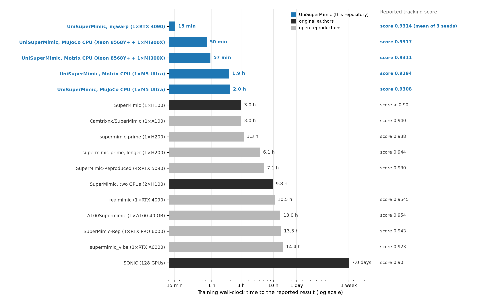
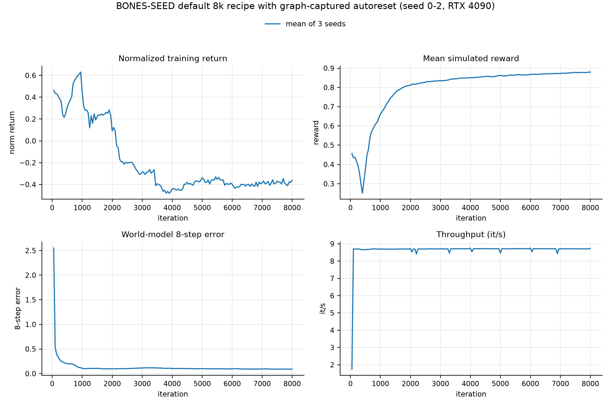

<h1 align="center">UniSuperMimic</h1>

<h3 align="center">基于 UniLab 的 SuperMimic 复现</h3>

<p align="center">语言：简体中文 | <a href="README.md">English</a></p>

<p align="center">
  <a href="https://arxiv.org/abs/2610.28480"></a>
  <a href="https://pypi.org/project/unilab/"></a>
  <a href="#结果"></a>
  <a href="#结果"></a>
  <a href="LICENSE"></a>
</p>

UniSuperMimic 是 [SuperMimic](https://supermimic.github.io) 在 **UniLab** 上的独立下游复现，支持 **mjwarp、MuJoCo 和 Motrix** 后端，面向 Unitree G1 全身运动跟踪。仓库包含可微世界模型、目标条件策略、Manager-Based 任务、覆盖 40 段 LAFAN1 与 129,487 段 BONES-SEED 紧凑动作库的数据管线，以及训练和确定性全库评估入口。

### 特性亮点

- **大规模 BONES-SEED**：在同一个仓库内完成 129,487 段、4730 万帧动作库的下载、转换、过滤、打包、训练和确定性评估。
- **图捕获的固定形态 autoreset**：unilab 1.6.4 在 reset 间固定 body-packet 存储并发布调用方所有的 step 输出，reset 段因此以 CUDA 图重放运行——默认 8000 轮 BONES-SEED 配方在**单张 RTX 4090 上约 15 分钟**完成训练，不含一次性编译（3 seeds 均值：全库 norm_return 0.9314、clip 成功率 99.83%）。
- **单卡高效**：mjwarp、MuJoCo 和 Motrix 三个后端都支持高效单卡工作流；图捕获 autoreset 链下 learner 吞吐约 8.7 it/s。
- **三种仿真后端**：策略和数据集配置不变，可在 mjwarp、MuJoCo、Motrix 之间切换。

<p align="center">
  <a href="docs/assets/supermimic_comparison.mp4"></a>
</p>

<p align="center"><em>实体机器人为 SuperMimic 策略，蓝色半透明机器人为参考动作。点击图片查看 MP4。</em></p>

<p align="center">
  
</p>

<p align="center"><em>达到报告结果所需的训练墙钟时间（对数时间轴），右侧为各项目报告的跟踪分数。UniSuperMimic 的各行是同一默认配方在不同硬件与仿真后端上的结果（单 seed；RTX 4090 一行为 3 seeds 均值），其中 MuJoCo 与 Motrix 在 CPU 上仿真、learner 在 GPU 上；UniSuperMimic 的训练时间不含一次性编译。历史 run 与消融存档见 <a href="docs/results_history.md">docs/results_history.md</a>（英文）。</em></p>

论文：[*SuperMimic: Scaling Humanoid Whole-Body Control with One Differentiable World Model*](https://arxiv.org/abs/2610.28480)，Qiayuan Liao 等。实现参考 `supermimic_vibed`，上游依赖为 PyPI `unilab`。

## 仓库结构

```text
unisupermimic/
├── src/unisupermimic/
│   ├── rl/
│   │   ├── algos/supermimic/       # 世界模型、策略、critic、replay 和 learner
│   │   └── contracts/supermimic.py # 环境/算法张量协议
│   ├── tasks/motion_tracking/g1/supermimic/
│   │   ├── env.py                  # Manager-Based 环境与后端工厂
│   │   ├── manager_terms.py        # command/action/observation/event/reward terms
│   │   ├── motion.py, mdp.py       # 运动库与可微 MDP
│   │   ├── evaluate.py             # 首帧确定性全 clip 评估
│   │   ├── render.py               # 策略采样与参考动作对比视频
│   │   └── registry.py             # G1SuperMimic 注册
│   ├── scripts/train_supermimic.py # 训练、续训和 eval 入口
│   ├── conf/supermimic/            # Hydra 配置
│   ├── data/boneseed.py            # BONES-SEED 下载/转换/过滤/打包命令行入口
│   ├── assets/robots/g1/           # G1 MJCF；mesh/URDF 下载后不纳入 git
│   ├── assets/motions/             # LAFAN1 CSV，下载后不纳入 git
│   └── sim2sim.py                  # 策略 I/O、网络形状和资产身份校验
├── docs/assets/                    # 结果曲线、MP4 和 GIF
├── tools/prepare_supermimic_assets.py
├── tests/
├── pyproject.toml, uv.lock
├── LICENSE, LICENSES/, NOTICE
└── Makefile
```

## 安装

环境：Linux、Python 3.10–3.13、[uv](https://docs.astral.sh/uv/)；mjwarp 训练需要 CUDA GPU。以下命令均在仓库根目录执行，`uv run` 按 `uv.lock` 同步项目、PyPI `unilab`、三种仿真后端和开发依赖。

```bash
uv run unisupermimic-train --help
```

依赖变更后运行 `uv lock`。

AMD ROCm 主机改用预生成的 ROCm lockfile 安装（同样的依赖钉版，torch 为
ROCm 构建）：

```bash
make sync-rocm
```

CUDA-only 后端（mjwarp）在 ROCm 上不可用，请使用 MuJoCo host-bridge 后端
训练（`task=g1_super_mimic/mujoco`）。`make sync-rocm` 会把
`pyproject.toml`/`uv.lock` 换成 ROCm 配置档，切回默认配置档用
`make sync-default`。维护者在依赖变更后用 `make lock-rocm` 重新生成
ROCm lockfile。

### 准备资产并选择数据集

两种训练方式使用同一个 G1 机器人模型，但**只需下载你准备用于训练的数据集**。LAFAN1 和 BONES-SEED 是两个独立选项，选择其中一个并不需要下载另一个。

### 共享 G1 机器人资产

如果只使用 BONES-SEED，可以只准备机器人，不下载任何 LAFAN1 动作：

```bash
uv run tools/prepare_supermimic_assets.py --robot-only

# 可选：离线校验已有的机器人资产
uv run tools/prepare_supermimic_assets.py --robot-only --validate-only
```

### 选项 A：LAFAN1

适合默认的 40 段动作训练。以下命令会同时准备共享机器人和 LAFAN1/G1 动作，无需再执行上面的 `--robot-only` 命令：

```bash
uv run tools/prepare_supermimic_assets.py

# 离线校验机器人和全部 LAFAN1 动作
uv run tools/prepare_supermimic_assets.py --validate-only
```

数据源为 `lvhaidong/LAFAN1_Retargeting_Dataset`。完整动作集包含 40 段 CSV、264705 个源帧，每帧 36 列。

### 选项 B：BONES-SEED

适合大规模动作训练。如果共享机器人尚未准备好，先执行上面的 `--robot-only` 命令，然后运行：

```bash
# 完整 BONES-SEED 流程：下载 -> 转换 -> 过滤 -> 打包
uv run unisupermimic-boneseed all --workers 16

# 已有原始 CSV 时，可断点续跑或单独执行各阶段
uv run unisupermimic-boneseed convert --workers 16
uv run unisupermimic-boneseed filter --workers 16
uv run unisupermimic-boneseed pack
```

该流程与 `SuperMimic-Reproduced` 一致：把 120 fps CSV 重采样为带 MuJoCo 正运动学结果的 50 Hz NPZ，执行名称与可行性过滤，再将保留的 clip 打包为 71 维 fp16 运动库。数据源是 Hugging Face `bones-studio/seed` 的 `g1.tar.gz`。

默认原始 CSV 目录为 `data/raw/bones_seed`，NPZ 与 manifest 目录为 `data/npz/bones_seed`，训练库输出为 `data/library/bones_seed_compact.pt`。转换会跳过已有 NPZ，`--overwrite` 可强制重建，`--limit` 可先做小规模试跑。参考全量结果约有 12.95 万段运动，fp16 库约 6.7 GB 并常驻训练设备，原始 CSV 和中间 NPZ 还需要额外磁盘空间。

mesh、URDF、动作文件、日志、checkpoint 和生成的数据集目录均被 `.gitignore` 排除；数据集许可证仍归各自所有者。

## 训练

以下命令从仓库根目录运行；使用 CUDA 时，把 `CUDA_VISIBLE_DEVICES` 改为实际空闲 GPU。两个数据集都使用 `unisupermimic-train`，通过运动文件配置选择对应的训练入口。

### 使用 LAFAN1 训练

LAFAN1 是默认数据集，无需覆盖运动文件：

```bash
# mjwarp、4096 个并行环境、8000 iterations
CUDA_VISIBLE_DEVICES=0 uv run unisupermimic-train \
  training.log_dir=runs/supermimic_mjwarp_001

# 从该 LAFAN1 run 的 last.pt 续训到 16000 iterations
CUDA_VISIBLE_DEVICES=0 uv run unisupermimic-train \
  algo.resume=true \
  algo.load_run=runs/supermimic_mjwarp_001 \
  algo.checkpoint=last.pt \
  algo.iterations=16000
```

### 使用 BONES-SEED 训练

生成紧凑运动库后，通过 `env.commands.motion.motion_files` 显式选择它。该参数会替换默认的 LAFAN1 列表，而不是把两个数据集合并：

```bash
CUDA_VISIBLE_DEVICES=0 uv run unisupermimic-train \
  'env.commands.motion.motion_files=[data/library/bones_seed_compact.pt]' \
  training.log_dir=runs/supermimic_boneseed_001

# 使用相同的数据集配置续训 BONES-SEED run
CUDA_VISIBLE_DEVICES=0 uv run unisupermimic-train \
  'env.commands.motion.motion_files=[data/library/bones_seed_compact.pt]' \
  algo.resume=true \
  algo.load_run=runs/supermimic_boneseed_001 \
  algo.checkpoint=last.pt \
  algo.iterations=16000
```

带引号的 Hydra 列表里是一个运动库文件，不代表只有一段动作；实际 clip 信息从库中读取。通过 `unisupermimic-train` 续训或评估 BONES-SEED run 时，也要保留这个数据集覆盖参数。

### 后端与其他选项

后端选择与数据集选择相互独立。以下示例使用默认 LAFAN1；如需 BONES-SEED，在命令中加上面的运动文件覆盖参数即可：

```bash
# 通过 task owner 选择 MuJoCo
uv run unisupermimic-train \
  task=g1_super_mimic/mujoco \
  training.log_dir=runs/supermimic_mujoco_001

# 通过 task owner 选择 Motrix
uv run unisupermimic-train \
  task=g1_super_mimic/motrix \
  training.log_dir=runs/supermimic_motrix_001
```

续训或评估 MuJoCo、Motrix run 时，使用与训练相同的 `task=g1_super_mimic/<backend>` 覆盖。三个后端使用相同的摩擦、质心和关节偏置域随机化。其他配置覆盖使用 Hydra 语法，例如快速 smoke 可覆盖 `algo.num_envs`、`algo.iterations`、`algo.wm_hidden`、`algo.policy_hidden` 和 `algo.compile=false`。默认完整配置见 `src/unisupermimic/conf/supermimic/config.yaml`。

默认优化器仍为 Adam。如需对 policy 和 world model 的隐藏层权重矩阵启用 Muon（输入/输出层、向量参数、normalizer 与 critic 仍使用 Adam），添加：

```bash
algo.pi_opt=muon algo.wm_opt=muon
```

Muon 使用 `match_rms_adamw` 缩放，因此沿用现有 `algo.lr` 和余弦学习率调度。两个选项也可以单独启用。

## 评估

评估从每段动作的首帧开始，关闭观测/动作噪声，并跑完整个 clip。已结束的环境会被回收给待评估动作；调度器优先启动较长 clip，避免固定 batch 出现长空闲尾巴。独立评估器默认最多使用 16,384 个并行环境，可用 `unisupermimic-eval --num_envs N` 适配较小 GPU。严格 sim2sim 校验会在环境构造前检查策略 I/O、网络形状、运动库和 MJCF 身份。

独立评估和视频导出入口支持 `--backend mjwarp`、`--backend mujoco`、`--backend motrix`，默认为 mjwarp：

```bash
CUDA_VISIBLE_DEVICES=0 uv run unisupermimic-eval \
  --backend mjwarp \
  --ckpt runs/supermimic_mjwarp_001/ckpt_012000.pt
```

### Viser 批量渲染

直接评估 checkpoint 时添加 `--viser`，即可在浏览器中同时查看多个确定性回放。该功能复用 UniLab 的 Viser 渲染器，无需本地显示器或 `MUJOCO_GL`：

```bash
CUDA_VISIBLE_DEVICES=0 uv run unisupermimic-eval \
  --backend mjwarp \
  --ckpt runs/supermimic_mjwarp_001/ckpt_012000.pt \
  --viser \
  --viser_max_envs 16 \
  --viser_port 8080
```

评估器会读取 checkpoint 所在目录的 `run_config.json`，复用其中记录的动作库，无需额外传入动作文件覆盖。上面的示例使用该 run 的 LAFAN1 动作库。若要渲染 BONES-SEED，改为选择 BONES-SEED checkpoint 即可；其 run 配置会自动选择 `data/library/bones_seed_compact.pt`：

```bash
CUDA_VISIBLE_DEVICES=0 uv run unisupermimic-eval \
  --backend mjwarp \
  --ckpt runs/supermimic_boneseed_001/ckpt_012000.pt \
  --viser \
  --viser_max_envs 16
```

如果 `run_config.json` 不存在，评估器回退到默认 LAFAN1 动作库。

打开 <http://localhost:8080>。**Controls** 面板可切换批量网格和单环境视图，并提供暂停、单步及变速控制。Viser 模式默认最多创建 16 个仿真环境；使用 `--num_envs N` 调整实际并行 batch 大小，使用 `--viser_max_envs N` 限制网格中显示的环境数。已结束的环境会装载待播放 clip，动作库全部播放完后循环回放各自分配的 clip。其他选项包括 `--render_spacing`、`--viser_display single`、`--viser_env_idx`、`--start_paused` 和 `--speed`。在终端按 Ctrl+C 停止服务。

对于远程 GPU 服务器，先执行 `ssh -L 8080:localhost:8080 <server>` 转发端口，再打开浏览器。Viser 用于交互式查看，不会写出 MP4；如需视频文件，请使用下面的视频导出入口。

## 视频导出

以下命令从 checkpoint 连续采样 `jumps1_subject1`，截取第 6–14 秒的跳跃片段，生成 25 fps 的参考动作对比 MP4：

```bash
CUDA_VISIBLE_DEVICES=0 MUJOCO_GL=egl uv run unisupermimic-video \
  --backend mjwarp \
  --ckpt runs/supermimic_mjwarp_001/ckpt_012000.pt \
  --clip jumps1_subject1 \
  --start 6 \
  --seconds 8 \
  --output docs/assets/supermimic_comparison.mp4
```

默认将参考动作的 root XY 对齐策略，便于观察全身跟踪；传入 `--global-ghost` 可保留参考动作的全局位移。

## 结果

历史结果表与消融（LAFAN1、12000 轮 BONES-SEED、EMA/no-sync、Muon 以及开图前的默认配方）存档于 [docs/results_history.md](docs/results_history.md)（英文）。

默认配方通过单一开关 `env.autoreset_cuda_graph` 启用 unilab 1.6.4 的固定形态 autoreset 全链：masked autoreset、持久 step 载体、延迟有限值校验，以及叠加在任务侧固定地址状态发布载体之上的 reset 段 CUDA 图捕获。确定性评估保持逐行 reset 生命周期，评估契约不变。

三个 seed（mjwarp、4096 环境、每个 seed 一张 RTX 4090、完整 129,487 段库）；16,384 环境从首帧起无噪声的确定性全库评估。失败段指回放在片段结束前硬终止（摔倒）——即 SuperMimic 家族协议。以下数字为 3 seeds 均值。训练时间是 8000 轮的 learner 墙钟时间去掉一次性编译：首轮 `torch.compile` 的停顿（这几次 run 中为 6–94 秒，取决于编译缓存）被扣除，因此该数字不受缓存冷热影响。

| 策略（8000 轮） | norm return | 帧加权 | 失败段 | 成功率 | 训练时间（不含一次性编译） |
|---|---:|---:|---:|---:|---:|
| 默认配方 + `env.autoreset_cuda_graph` | **0.9314** | **0.9271** | **226** | **99.83%** | **15.3 分钟** |

稳态 learner 吞吐约 8.7 it/s（第 1000–8000 轮）；8000 轮在单张 RTX 4090 上约 15 分钟完成。



## 测试

```bash
make check       # ruff、mypy、pyright
make test        # 非 slow 测试
make test-all    # 包含真实后端 slow 测试；mjwarp 需要 CUDA
uv run tools/prepare_supermimic_assets.py --validate-only
```

## License

本仓库代码采用 [Apache-2.0](LICENSE)。参考实现的 MIT 许可及原始版权声明完整保存在 [LICENSES/MIT-supermimic.txt](LICENSES/MIT-supermimic.txt) 和 [LICENSES/MIT-supermimic-reproduced.txt](LICENSES/MIT-supermimic-reproduced.txt)，另见 [NOTICE](NOTICE)。UniLab、UniSim、MuJoCo/mjwarp、MotrixSim 和数据集分别遵循其上游许可；本仓库不重新许可这些外部依赖或下载资产。
